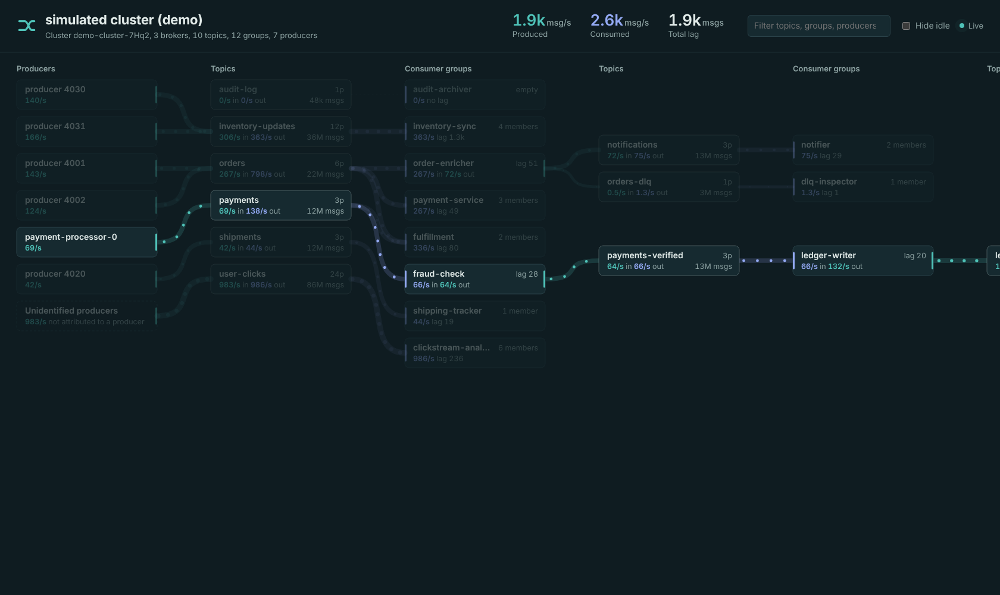

# Kafka Flow Viewer

A live view of what is flowing through a Kafka cluster: **producers → topics → consumer groups**, with messages per
second on every link, consumer lag, and a warning colour when a group's lag keeps growing.

It is a small Java 21 app (one dependency: `kafka-clients`) that polls the cluster with the AdminClient and streams
snapshots to a browser page over Server-Sent Events. It is read-only: it never produces, consumes or joins a group.



## Run it

```bash
mvn package                                  # builds target/kafka-flow-viewer.jar
java -jar target/kafka-flow-viewer.jar --demo                       # simulated cluster, no Kafka needed
java -jar target/kafka-flow-viewer.jar --bootstrap localhost:9092   # your cluster
```

Then open <http://localhost:8080>.

To try it against a real broker with real traffic:

```bash
docker compose up -d                          # single-node Kafka on localhost:9092
java -cp target/kafka-flow-viewer.jar io.kafkaflow.tools.LoadGenerator localhost:9092
java -jar target/kafka-flow-viewer.jar --bootstrap localhost:9092
```

The load generator creates `demo.*` topics, a few producers (one transactional) and consumer groups, including
`slow-reporting`, which is deliberately too slow so you can watch its lag climb. It also runs a two-step processing
chain, `demo.orders → order-enricher → demo.orders-enriched → shipping → demo.shipments → tracking`, using
exactly-once consume-process-produce. Don't run it against production.

## Using the UI

- **Hover** a node to highlight its lineage, everything upstream and downstream of it; **click** it for details: rate and lag history,
  per-topic breakdown, group members with their client id, host and partition count.
- **Filter** matches topic, group and producer names; a topic is shown if it, or anything connected to it, matches.
- **Hide idle** removes topics with no traffic in or out.
- Link thickness and particle speed follow the rate (log scale). Dotted grey links carry nothing right now.
  A consume link turns red when that group's lag on that topic has been trending up for the last ~10 samples.

## Processing chains

When a consumer group also writes to other topics (consume → transform → produce), the viewer draws it as a
processing step, so pipelines read left to right across as many columns as they need:

```
payment-processor → payments → fraud-check → payments-verified → ledger-writer → ledger-entries → reporting
```

Kafka has no record of which producer belongs to which consumer group, so the link is made by naming: a producer
whose `transactional.id` equals the group id, or starts with `<group id>-`, is folded into that group. Kafka Streams
does this on its own with `processing.guarantee=exactly_once_v2` (`group.id` = `application.id`, transactional ids
`<application.id>-…`), and so does any hand-written exactly-once relay that follows the convention. Relays that
aren't transactional still show up, but as separate producer nodes, so the chain appears broken at that step.

Hovering or selecting any node highlights its whole lineage: everything upstream that feeds it and everything
downstream that depends on it.

## How the numbers are measured

Every value is the difference between two samples (every `poll.interval.ms`, default 2 s), smoothed with an
exponential moving average (`rate.smoothing`).

| What | Source |
|---|---|
| Topic in-rate | growth of each partition's end offset (`listOffsets`) |
| Group consume rate | growth of the group's committed offsets (`listConsumerGroupOffsets`) |
| Lag | end offset − committed offset, summed over partitions |
| Group members | `describeConsumerGroups`: client id, host, assigned partitions |
| Producers and their rate | `describeProducers` (KIP-664): each producer's last sequence number per partition, which grows by one per record |
| Producer names | transactional id via `listTransactions`, when the producer has one |
| Group → producer (chains) | transactional id starting with the group id, see [Processing chains](#processing-chains) |

### Limits worth knowing

- **Kafka does not track producers by `client.id`.** Brokers only remember idempotent/transactional producers, by
  numeric producer id. Idempotence is on by default since Kafka 3.0 clients, so most modern producers show up as
  `producer <id>`; transactional ones show their `transactional.id`. A restarted producer gets a new id.
- Traffic that no identified producer explains (older or non-idempotent clients, brokers before 3.0) is drawn as
  **Unidentified producers**, so every busy topic still has an inflow.
- Consumption is seen through **committed offsets**. Consumers that never commit (manual `assign()` without commits,
  some stream processors) are invisible; a group that commits every 5 s will show its rate in steps.
- Brokers keep idle producer ids for up to a day (`producer.id.expiration.ms`), so the viewer hides producers that
  haven't written for `producers.idle.timeout.ms` (60 s).
- On clusters with many thousands of partitions, `describeProducers` is the heaviest call. Narrow the view with
  `topics.include` / `topics.exclude`, raise `poll.interval.ms`, or set `producers.enabled=false`.

## Configuration

Put settings in `kafka-flow.properties` in the working directory, pass `--config file.properties`, or use
`--set key=value`. Every `kafka.*` key is handed to the AdminClient with the prefix removed, so anything the Kafka
client supports works. See [`kafka-flow.example.properties`](kafka-flow.example.properties) and the defaults in
[`src/main/resources/default.properties`](src/main/resources/default.properties).

| Key | Default | |
|---|---|---|
| `http.port` | `8080` | UI port |
| `poll.interval.ms` | `2000` | sampling interval |
| `rate.smoothing` | `0.5` | 0 = raw rates, closer to 1 = smoother |
| `topics.include` / `topics.exclude` | empty | Java regex on the full topic name |
| `groups.include` / `groups.exclude` | empty | Java regex on the group id |
| `topics.internal` | `false` | show `__consumer_offsets` and friends |
| `producers.enabled` | `true` | turn producer discovery off |
| `producers.idle.timeout.ms` | `60000` | hide producers silent for longer than this |

Secured cluster example:

```properties
kafka.bootstrap.servers=broker1:9093,broker2:9093
kafka.security.protocol=SASL_SSL
kafka.sasl.mechanism=SCRAM-SHA-512
kafka.sasl.jaas.config=org.apache.kafka.common.security.scram.ScramLoginModule required username="viewer" password="…";
```

### ACLs for the viewer's principal

- `Describe` on the cluster
- `Describe` on topics (and `Read` on topics for producer discovery via `describeProducers`)
- `Describe` on consumer groups
- `Describe` on transactional ids (optional, only to name transactional producers)

## HTTP API

| Endpoint | |
|---|---|
| `GET /api/snapshot` | latest snapshot as JSON |
| `GET /api/stream` | `text/event-stream`, one `snapshot` event per poll |

Useful if you want to feed the same data into another tool.

## Project layout

```
src/main/java/io/kafkaflow/
  KafkaFlowViewer.java          entry point: poll loop + web server
  config/AppConfig.java         properties file + CLI flags
  source/KafkaClusterSource     AdminClient sampling (offsets, groups, producers)
  source/SimulatedClusterSource --demo data
  flow/FlowCalculator           counters -> rates, lag, links
  web/WebServer                 JDK HttpServer, static UI + SSE
  tools/LoadGenerator           test traffic for a dev cluster
src/main/resources/web/         the UI (plain HTML/CSS/JS, no build step, works offline)
```

The client is `kafka-clients` 3.9.1, which talks to any broker from 2.1 upwards, including 4.x. Bump
`kafka.version` in the pom if you prefer a 4.x client.
